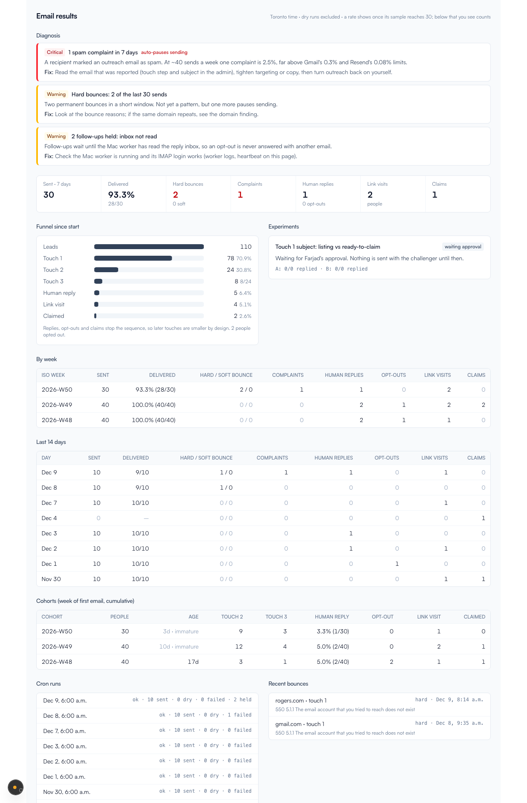
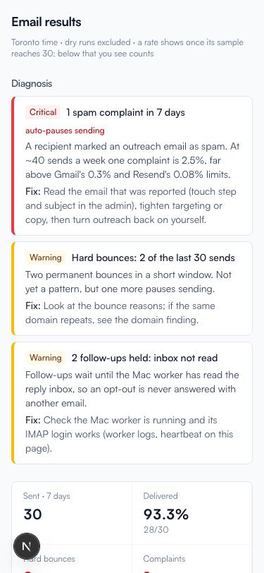

# Outreach learning: measurement, diagnosis, experiments (Nov 2026)

The goal is for email outreach to tell Farjad how sending is going and what is wrong, without him digging.

**Why there's no auto-tuning.** At 10 emails a day, Mon–Thu (about 40 a week), self-tuning is noise. A 10% reply rate
on one week's sends has a 95% interval of roughly 3–26%. So v1 is built in this order:

1. measurement
2. rule-based diagnosis that counts events instead of trusting percentages
3. one A/B test that stays switched off until Farjad approves it, and that won't name a winner before a minimum sample

*(Screenshots use fixture data: three weeks at 10/day, one complaint, two hard bounces.)*

## Data captured

| Where | What | Why |
|---|---|---|
| `OutreachTouch.deliveredAt / bouncedAt / bounceType / bounceReason / complainedAt` | Resend webhook outcome per touch. Permanent = `hard`, Transient = `soft`, anything else = null (unclassified) | Bounce and complaint rates per touch and per day, plus bounce-domain clustering |
| `OutreachTouch.variant` | `<experimentId>:<arm>`; null when no experiment runs | A/B readout |
| `OutreachLead.claimedAt` | Set once, the first time the lead is saved as CLAIMED | Claims by day, and only claims made after first contact count |
| `OutreachRun` | One row per `/api/cron/outreach-email` run: status, sent, dry-run, failed and held counts, error | "The cron didn't run" and compose-failure rules |
| `AnalyticsEvent` (existing) | `page_view` with `utm_source=outreach&utm_medium=email`; the licence number comes from `metadata.url` | Link visits per person (a proxy: scanners and forwarded links can inflate it) |

Migration `20261113120000_outreach_learning` only adds things (nullable columns and one table). Tested on a throwaway
Postgres 16 container: main schema → `migrate deploy` → `migrate diff` was empty. The DB integration suite passed 10/10
there, including a new learning test. It was never run against prod.

## Metric rules

- **Sent:** status SENT, or SCHEDULED whose send time has passed. DRY_RUN, FAILED, CANCELLED and QUEUED never count. UNCERTAIN is shown separately.
- **Per touch:** delivery, bounces and complaints, credited to the send day.
- **Per person:** replies, opt-outs (a negative reply or the unsubscribe link), link visits and claims, credited to the day they happened and only if after first contact.
- **Human reply:** a reply labelled positive or question. Auto-replies and negatives are shown on their own.
- **Cohort:** the ISO week of a person's first sent touch, counted up to now. Cohorts younger than 14 days are marked immature.
- **Sample size:** a rate is shown only when its denominator is at least 30, otherwise the counts are shown (`rate()` in `metrics.ts`, Wilson interval).

The full definitions are in `src/lib/outreach/metrics.ts`.

## Diagnosis rules (`src/lib/outreach/diagnosis.ts`)

Thresholds come from the email-marketing review, which used Google/Yahoo sender rules and Resend's limits (bounces under 4%, complaints under 0.08%).

| Rule | Fires when | Severity | Auto-pause |
|---|---|---|---|
| Spam complaint | any in 7 days | critical | yes, if under 26h old |
| Hard bounces | 2 in the last 30 sends | warn | no |
| Hard bounces | 3 in the last 30, or over 4% of the last 100 (with at least 50 sends) | critical | yes, if fresh |
| Soft-bounce streak | the last 3 outcomes all soft (critical at 5) | warn / critical | no |
| Bounce domain | one domain has 2+ bounces and at least half of all bounces in 30 days | warn | no |
| Webhook silent | 5+ sends over 2h old, none with any event | critical | yes, if fresh |
| Webhook partial | under half of 10+ sends have an event | warn | no |
| Unsubscribes | over 4% of 40+ people contacted in 28 days | warn | no |
| Reply collapse | human reply rate under 20% of the previous 28 days (80+ people in each window) | info | no |
| Cron missed | EMAIL on, run history exists, no run on the last active day | critical | no |
| Cron error | the last run failed | critical | no |
| Follow-ups held | the last run held follow-ups (inbox not read) | warn | no |
| Compose failures | 3+ failed, or 30%+ of 3+ attempts in the last run | warn | no |

`checkHealth` (`health.ts`) turns warn and critical findings into lines in the existing daily health email. A finding
marked `pause` switches outreach off through the same path as the existing negative-reply auto-pause. "Fresh" means
the triggering event is under 26h old, so turning outreach back on doesn't get undone the next morning by the same old
event.

## Weekly summary

On Mondays the daily health cron (10:00 UTC) also sends **"[Verixa outreach] Weekly summary 2026-Wxx"** to
`OUTREACH_ALERT_EMAIL`, once per ISO week (locked by `PlatformSetting outreach.weeklyReport.lastWeek`). It contains:

- last week next to the week before, with deltas
- the funnel since the start
- every finding
- the experiment status

## A/B framework (`src/lib/outreach/experiments.ts`)

- **The test:** two touch-1 subjects, split 50/50 by a deterministic hash of the lead id.
- **Body:** stays the approved template. Only the subject changes.
- **Success:** a human reply to touch 1 before touch 2 goes out. Opens are not used.
- **Decision rule:** Beta(1,19) prior, first look at 100 sends per arm (about 8 weeks at ~25 touch-1 sends a week).
  The challenger wins only if P(B > A) ≥ 95%. The test stops at 200 per arm (about 16 weeks) and keeps the control.
  Only a gap of about 3x is detectable.
- **Shipped with `approved: false`.** Going live takes a one-line PR that Farjad signs off. A winner is a recommendation;
  nothing switches the template automatically.

| Arm | Subject |
|---|---|
| A (control) | `Your CICC listing is on Verixa, {Name}` |
| B (proposed, needs approval) | `{Name}, your Verixa profile is ready to claim` |

## Deliberately not done / follow-ups

- **Soft bounces still suppress the lead**, as before. The email review recommends retrying soft bounces instead. That
  changes sending behaviour, so it's a separate decision.
- **Link attribution is inferred:** each click goes to the last touch before it. Adding `utm_content=<step>-<arm>` to
  links would make it observed, but it changes the approved email's URLs, so it needs approval.
- **No per-provider pause.** A domain cluster only warns.
- **Recontact cycle isn't a column.** It is only inside `idempotencyKey`.
